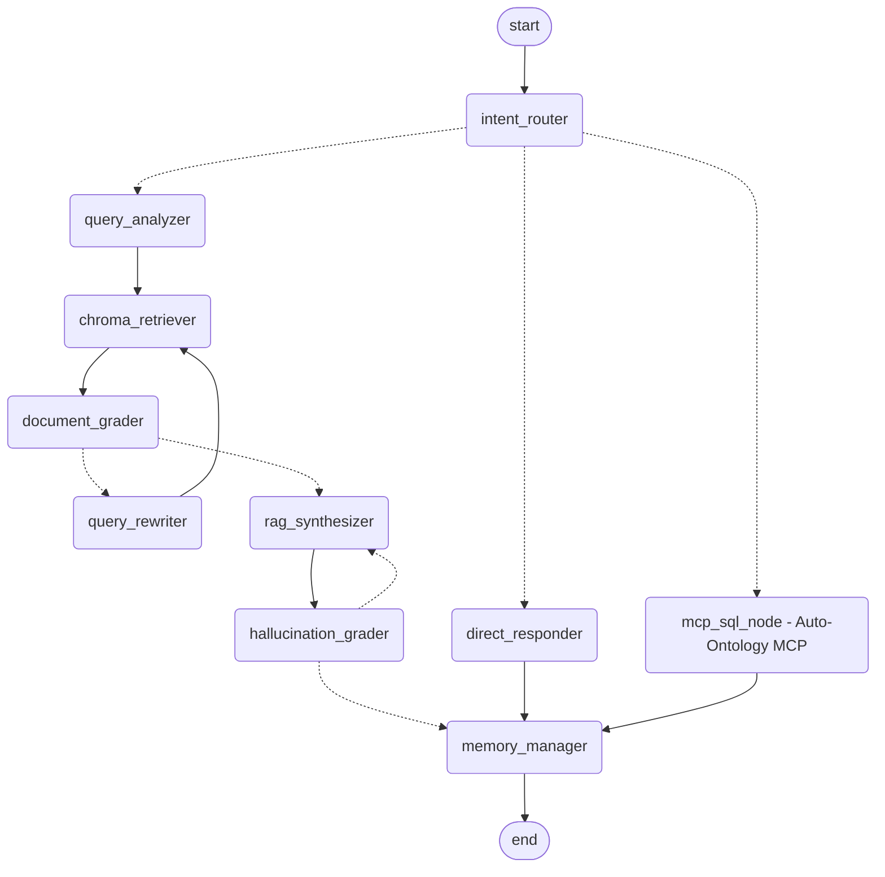

# CortexGraph

> **Agentic Second Brain & Personal Knowledge Assistant**  
> Built with LangGraph, OpenAI, ChromaDB, FastAPI, Langfuse, and NVIDIA Auto-Ontology.

## Overview

CortexGraph is an autonomous knowledge assistant combining unstructured note intelligence and structured enterprise database reasoning:
- **Unstructured Second Brain**: Indexes Markdown notes into ChromaDB, executes Corrective RAG (CRAG) with dynamic query rewriting, document grading, hallucination detection, and conversational memory summarization.
- **Structured Enterprise Knowledge**: Direct relational text-to-SQL reasoning powered by a **self-deployed NVIDIA Auto-Ontology** FastMCP service, integrated with the sample enterprise database **Wide World Importers** (`wideworldimporters`).

---

## Architecture

CortexGraph uses a multi-modal routing topology orchestrated via LangGraph:

```text
                                [User Request]
                                      │
                                      ▼
                               [intent_router]
                                ┌─────┼─────────────────────────┐
             (Direct Chitchat)  │     │ (Knowledge Query)       │ (Database / SQL)
                                ▼     ▼                         ▼
             [direct_responder]   [query_analyzer]       [mcp_sql_node]
                     │                │             (NVIDIA Auto-Ontology MCP)
                     │                ▼                         │
                     │       [chroma_retriever]                 │
                     │                │                         │
                     │                ▼                         │
                     │       [document_grader]                  │
                     │          ┌─────┴─────┐                   │
                     │ (Sufficient)     │ (Insufficient)        │
                     │          │       ▼                       │
                     │          │   [query_rewriter]            │
                     │          │       │ (Max 2 loops)         │
                     │          │       └────────┐              │
                     │          ▼                │              │
                     │   [rag_synthesizer] ◄─────┘              │
                     │          │                               │
                     │          ▼                               │
                     │ [hallucination_grader]                   │
                     │    ┌─────┴─────┐                         │
                     │(Grounded)   (Ungrounded)                 │
                     │    │             │                       │
                     │    │             ▼                       │
                     │    │      [rag_synthesizer]              │
                     │    │      (Regeneration)                 │
                     │    ▼                                     │
                     └─► [memory_manager] ◄─────────────────────┘
                                │
                                ▼
                         [Final Response]
```

### Compiled LangGraph Mermaid Topology



---

## NVIDIA Auto-Ontology & Wide World Importers Integration

CortexGraph connects to a **self-deployed NVIDIA Auto-Ontology** service via FastMCP streamable HTTP transport to perform semantic Text-to-SQL queries over enterprise relational data.

### 1. Connection Configuration

The application communicates with the self-deployed Auto-Ontology MCP server using the `AUTO_ONTOLOGY_MCP_URL` environment variable.

In your `.env`:
```bash
# NVIDIA Auto-Ontology FastMCP Service Endpoint
AUTO_ONTOLOGY_MCP_URL=http://localhost:3003/mcp
```

### 2. How the Connection Works
- **FastMCP Protocol**: CortexGraph establishes an async session via `fastmcp.Client` to interact with remote MCP tools.
- **Pre-flight Coverage (`check_answerable`)**: Before generating SQL, CortexGraph checks whether the ontology covers the entities and business concepts requested by the user.
- **Semantic Text-to-SQL (`ask_question`)**: The NVIDIA Auto-Ontology agent generates optimized SQL for the underlying schema, executes it, and returns structured results with natural language answers.
- **Auditable Citations**: Answers automatically cite relational tables and views conforming to `[Source: db://wideworldimporters#<table>]`.

### 3. Demo Example Queries (Wide World Importers)
When querying the system, CortexGraph automatically routes enterprise queries to NVIDIA Auto-Ontology:
- *"What are the top 5 customers by sales volume in Wide World Importers?"*
- *"What is our total sales revenue for Wide World Importers?"*
- *"Show me stock items that have low inventory counts in warehouse."*

---

## Exporting & Importing NVIDIA Auto-Ontology Data

To copy or migrate the NVIDIA Auto-Ontology configuration, semantic ontology definitions, and sample data to another workspace:

### 1. Exporting from the Source Instance
1. **Export Ontology & Semantic Mappings**:
   - Locate the Auto-Ontology configuration directory (typically inside your Auto-Ontology deployment mount or workspace).
   - Export the semantic ontology definitions, domain terms, relationship graph, and schema mappings (YAML/JSON):
     ```bash
     # Example: archive ontology definitions and schema configs
     tar -czvf auto_ontology_backup.tar.gz ./ontology_definitions ./schema_mappings
     ```
2. **Export Database Schema & Seed Data (Wide World Importers)**:
   - If using SQL Server / PostgreSQL / SQLite backend for Wide World Importers:
     ```bash
     # PostgreSQL example:
     pg_dump -U postgres -d wideworldimporters -F c -b -v -f wideworldimporters_dump.backup
     
     # Or export DDL + CSV seeds:
     pg_dump -U postgres -d wideworldimporters --schema-only > wideworldimporters_schema.sql
     ```
3. **Export Auto-Ontology Vector / Embeddings Cache (Optional)**:
   - Archive any pre-built concept embedding caches or FAISS/vector indexes if generated during ontology ingestion.

### 2. Importing into a New Workspace
1. **Restore Relational Database**:
   - Provision your target database server and restore the Wide World Importers schema/data:
     ```bash
     createdb -U postgres wideworldimporters
     pg_restore -U postgres -d wideworldimporters -v wideworldimporters_dump.backup
     ```
2. **Deploy NVIDIA Auto-Ontology Container**:
   - Launch the Auto-Ontology container mapping the restored ontology definitions:
     ```bash
     docker run -d \
       --name nvidia-auto-ontology \
       -p 3003:3003 \
       -v /path/to/ontology_definitions:/app/ontology \
       -e DATABASE_URL="postgresql://postgres:password@db:5432/wideworldimporters" \
       nvidia/auto-ontology:latest
     ```
3. **Connect CortexGraph**:
   - Point `AUTO_ONTOLOGY_MCP_URL` in `.env` to the new endpoint:
     ```bash
     AUTO_ONTOLOGY_MCP_URL=http://localhost:3003/mcp
     ```
   - Verify connection by running the integration suite:
     ```bash
     pytest tests/integration/test_sql_graph_flow.py -v
     ```

---

## Quick Start

### 1. Prerequisites
- Python >= 3.11
- [uv](https://docs.astral.sh/uv/) (recommended) or standard `pip`
- Docker & Docker Compose (optional for local ChromaDB / MCP dependencies)

### 2. Environment Setup
```bash
cp .env.example .env
# Edit .env with your OpenAI API keys and AUTO_ONTOLOGY_MCP_URL
```

### 3. Install Dependencies
```bash
make setup
```

### 4. Run Tests & Linter
```bash
make test
make lint
```

### 5. Run Application
```bash
make run
```
Access the Swagger UI at `http://localhost:8000/docs` and healthcheck at `http://localhost:8000/health`.

### 6. Containerized Deployment
```bash
docker compose up --build
```
