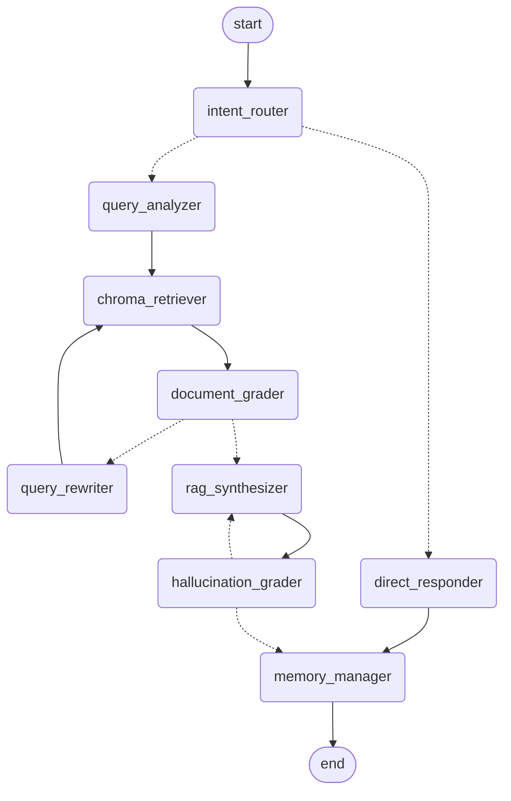

# CortexGraph

> **Agentic Second Brain & Personal Knowledge Assistant**  
> Built with LangGraph, OpenAI, ChromaDB, FastAPI, and Langfuse.

## Overview

CortexGraph is an autonomous knowledge assistant that indexes your markdown notes, performs corrective RAG (CRAG) retrieval, grades context relevance, self-corrects hallucinations, and maintains structured conversational memory.

## Architecture

```text
[User Request]
       │
       ▼
 [intent_router] ──(Direct Chitchat)──► [direct_responder] ──► [memory_manager]
       │
   (RAG Need)
       ▼
[query_analyzer] ──► [chroma_retriever] ──► [document_grader]
                                                    │
                                  ┌─────────────────┴─────────────────┐
                            (Sufficient)                         (Insufficient)
                                  │                                    │
                                  ▼                                    ▼
                          [rag_synthesizer] ◄───(Rewrite)─── [query_rewriter]
                                  │                              (Max 2 Loops)
                                  ▼
                        [hallucination_grader]
                                  │
                 ┌────────────────┴────────────────┐
             (Grounded)                       (Ungrounded)
                 │                                 │
                 ▼                                 ▼
         [memory_manager]                   [rag_synthesizer]
                 │                           (Regeneration)
                 ▼
          [Final Response]
```

### Compiled LangGraph Mermaid Topology



## Quick Start

### 1. Prerequisites
- Python >= 3.11
- [uv](https://docs.astral.sh/uv/) (recommended) or standard `pip`
- Docker & Docker Compose (optional for local ChromaDB)

### 2. Environment Setup
```bash
cp .env.example .env
# Edit .env with your configuration
```

### 3. Install Dependencies
```bash
make setup
```

### 4. Run Tests & Linter
```bash
make test
make lint
```

### 5. Run Application
```bash
make run
```
Access the Swagger UI at `http://localhost:8000/docs` and healthcheck at `http://localhost:8000/health`.

### 6. Containerized Deployment
```bash
docker compose up --build
```
